# remarkable-skills

Skills voor Claude Code waarmee je je reMarkable slimmer gebruikt. Je zegt wat je wilt, Claude regelt de rest. Er zijn twee hoofdstukken:

- [Weekplanner voor je reMarkable](#weekplanner)
- [Slimme briefings voor je reMarkable](#briefings)

<a id="weekplanner"></a>

## Weekplanner voor je reMarkable

Je agenda zit in je telefoon, je focus op papier. Dit hoofdstuk lost dat op: elke week krijg je een planner van 12 pagina's met je echte agenda en je weekdoelen. Per werkdag een dagpagina (agenda per uur met timebox-kader, vier prioriteiten, notities) en een kort dagboek (ochtend: waar ben je dankbaar voor, avond: drie mooie dingen). Het weekend krijgt een eigen dagboekpagina. Je begint de week met overzicht en focus.

Skill: **weekplanner**. Hij gebruikt ook `remarkable-sturen`, om de planner op je tablet te zetten.

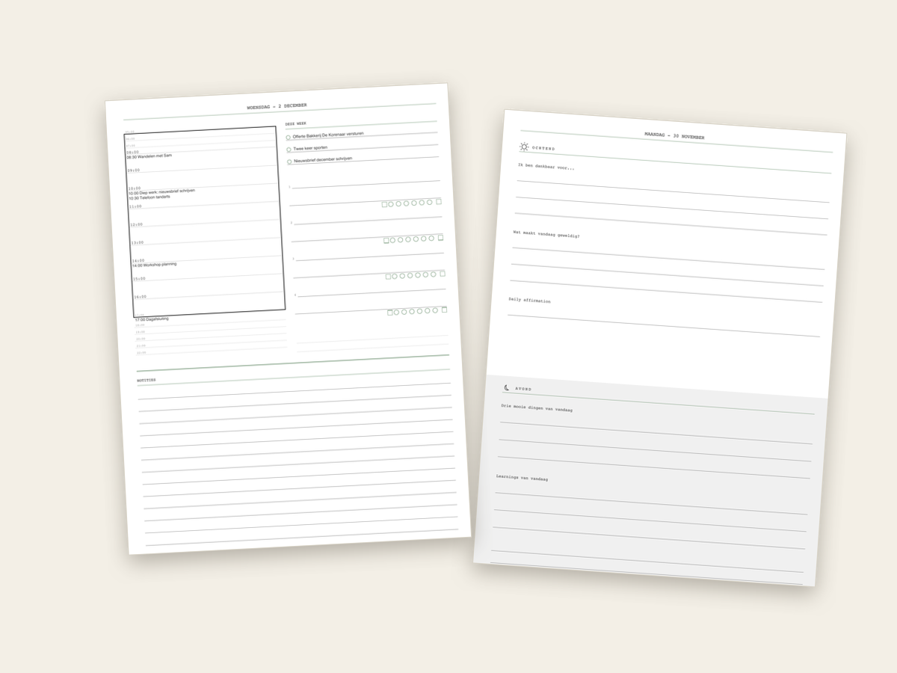

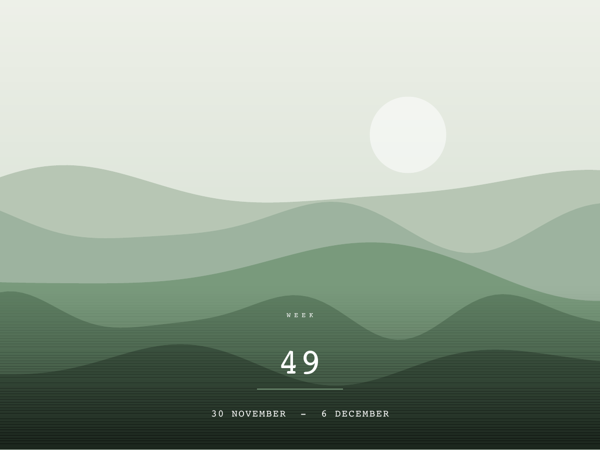

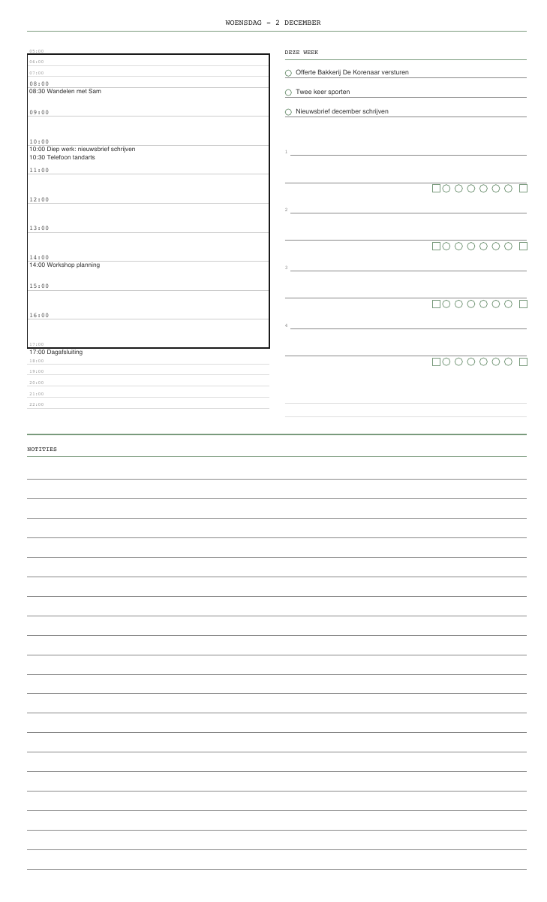 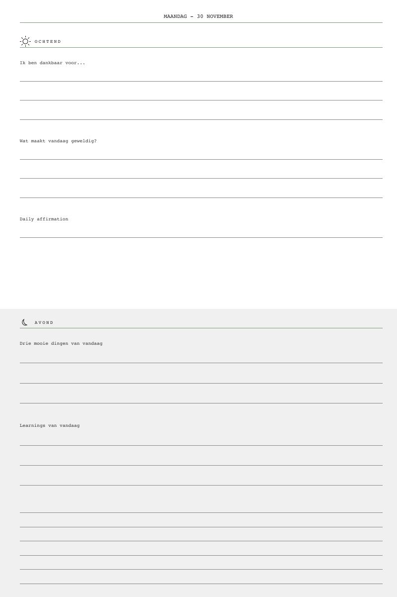 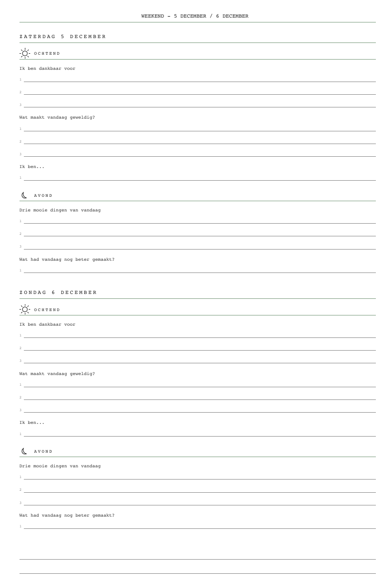

Zo gebruik je het (na de [installatie](#installatie-stap-voor-stap)):

| Je zegt | Wat er gebeurt |
|---|---|
| "Maak mijn weekplanner" | Claude vraagt om je weekdoelen en maakt de PDF |
| "Maak mijn weekplanner voor volgende week en stuur hem naar mijn reMarkable" | PDF wordt gemaakt en verstuurd |

Je agenda komt uit Google Agenda of Outlook, via een iCal/ICS-link. Een `.ics`-bestand kan ook. Hoe je de link vindt, staat in `skills/weekplanner/SKILL.md`. De planner is standaard liggend, staand kan ook. Een voorbeeld-PDF staat in `examples/voorbeeld-weekplanner.pdf`.

<a id="briefings"></a>

## Slimme briefings voor je reMarkable

Rapporten, nieuwsbrieven en analyses lees je op je laptop zelden echt. Ze blijven liggen. Dit hoofdstuk zet ze als rustige briefing op je reMarkable: inhoud, kernpunten en ruimte voor je pen. Je leest wat ertoe doet, met de pen in de hand. En daarna haalt Claude je aantekeningen weer op en verwerkt ze.

Skills: **remarkable-briefing** (tekst naar briefing-PDF in het formaat van je scherm), **nieuwsbrief-naar-remarkable** (een nieuwsbrief of artikel, via link of tekst, naar je tablet), **remarkable-sturen** (een PDF naar je reMarkable Cloud) en **remarkable-ophalen** (een document met je aantekeningen terughalen).

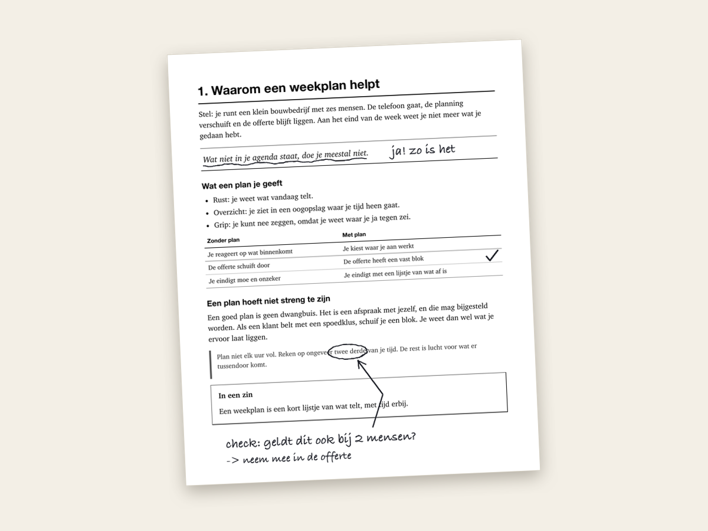

### Zo werkt het, in 3 stappen

**1. Sturen.** Je zegt tegen Claude:

> Zet deze complete analyse als briefing op mijn reMarkable, dan lees ik hem straks na.

Claude maakt een rustige briefing-PDF en zet hem op je tablet.

**2. Lezen en schrijven.** Je leest op je reMarkable. Je onderstreept, omcirkelt en schrijft je commentaar in de kantlijn.

**3. Ophalen en verwerken.** Later zeg je:

> Ik heb hem nagelezen en comments gezet, haal ze op en verwerk ze.

Claude haalt het document met je aantekeningen op, maakt van elke pagina een afbeelding en leest je handschrift. Je krijgt eerst een lijstje van wat er staat. Daarna verwerkt Claude de punten.

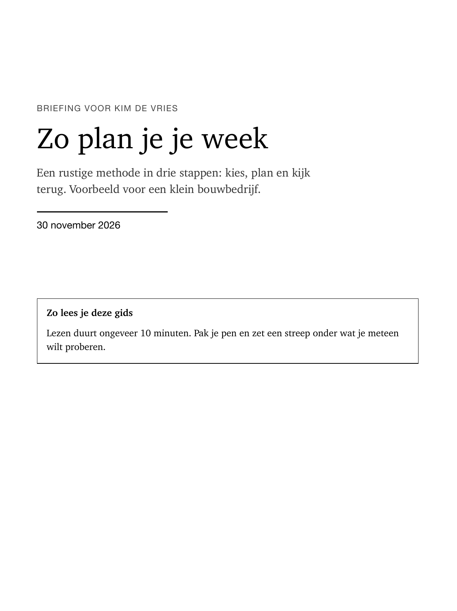 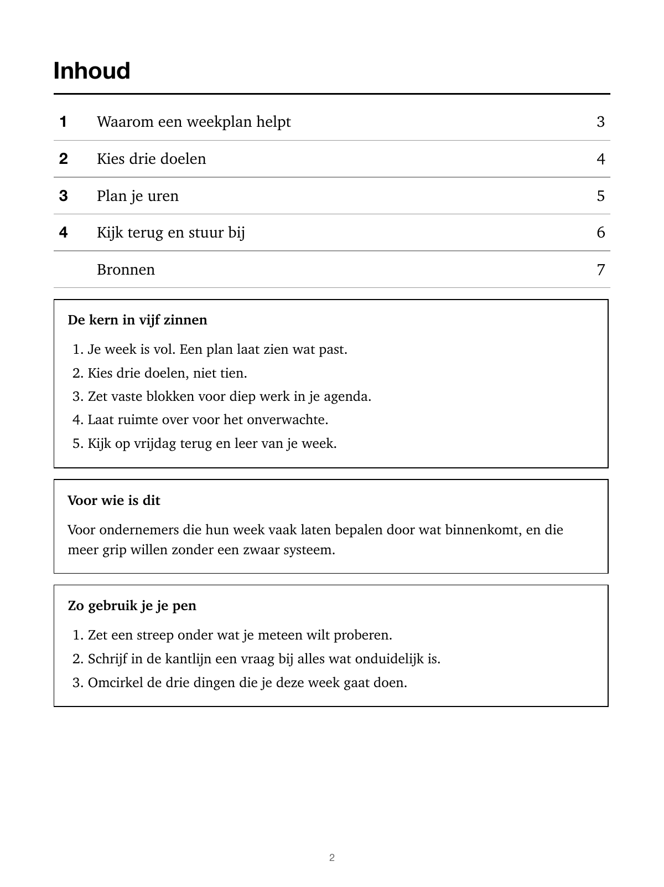
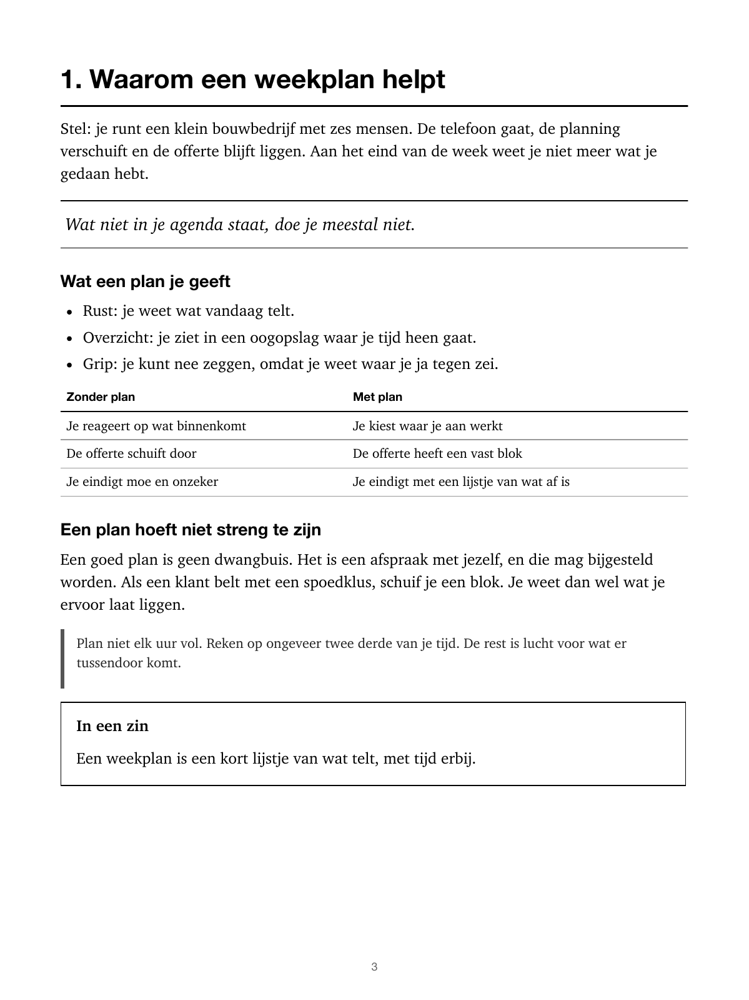 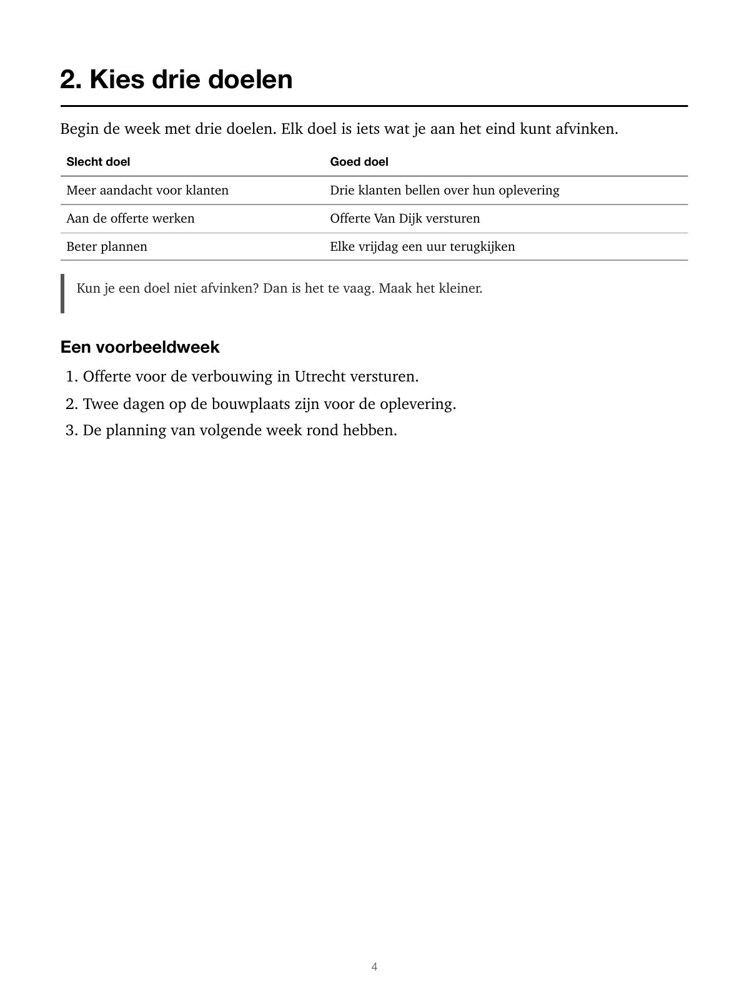
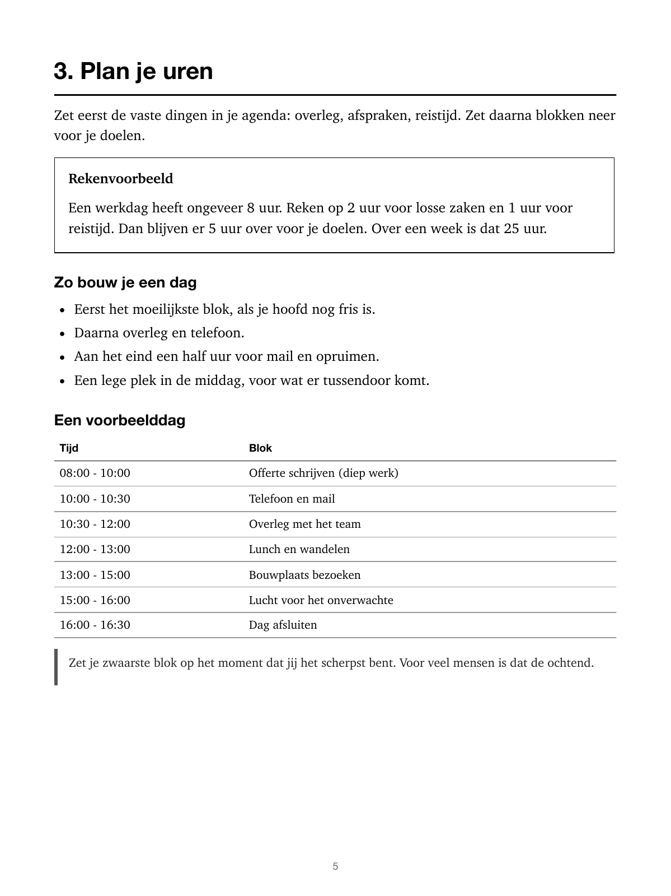

Meer dingen die je kunt zeggen (na de [installatie](#installatie-stap-voor-stap)):

| Je zegt | Wat er gebeurt |
|---|---|
| "Stuur dit naar mijn reMarkable" (met een PDF) | De PDF komt in je reMarkable Cloud |
| "Maak een briefing van notities.md" | Claude maakt een PDF in briefing-stijl |
| "Maak een briefing van https://... en zet hem op mijn reMarkable" | Link wordt een briefing en gaat naar je tablet |
| "Haal mijn aantekeningen van de briefing op" | Claude haalt het document terug en leest je handschrift |

Na het sturen synchroniseert je tablet binnen een paar minuten. Wil je het meteen? Tik op je reMarkable op het sync-icoon. Doe dat ook voordat Claude je aantekeningen ophaalt.

Een complete voorbeeld-PDF staat in `examples/voorbeeld-briefing.pdf`.

## Voor wie is dit?

Voor ondernemers en andere lezers met een reMarkable die Claude Code gebruiken. Je hoeft niet te kunnen programmeren. Je typt alleen een paar commando's over en daarna praat je gewoon met Claude.

Het werkt op een Mac en op Linux. Windows ondersteunen de skills niet.

## Installatie, stap voor stap

Je gebruikt de Terminal (op een Mac: druk op Cmd + spatie, typ "Terminal" en druk op Enter).

### Stap 1. Installeer Claude Code

Volg de uitleg op https://docs.claude.com/en/docs/claude-code/overview en log in. Test het: typ `claude` in de Terminal. Je ziet dan een chatvenster. Sluit af met `Ctrl + C` twee keer.

### Stap 2. Installeer Python 3 en de hulpprogramma's

1. Controleer Python: typ `python3 --version`. Zie je een nummer vanaf 3.9? Dan is het goed. Anders installeer je Python van https://www.python.org/downloads/.
2. Installeer poppler. Dit heb je nodig voor de paginanummers in de briefing. Op een Mac met Homebrew (https://brew.sh): `brew install poppler`. Op Linux: `sudo apt install poppler-utils`.
3. Je hebt een browser nodig: Google Chrome, Brave of Chromium. Een van die drie is genoeg. Je ziet hem niet openen. De skills gebruiken hem op de achtergrond om PDF's te maken, zonder geluid en zonder JavaScript.

### Stap 3. Download deze repo

Kopieer deze regel in de Terminal en druk op Enter:

```bash
git clone https://github.com/rogierlive/remarkable-skills.git ~/remarkable-skills
```

Liever zonder `git`? Ga naar https://github.com/rogierlive/remarkable-skills, klik op de groene knop **Code** en kies **Download ZIP**. Pak de zip uit. De map heet dan `remarkable-skills-main`. Hernoem hem naar `remarkable-skills` en zet hem in je thuismap.

Ga in de Terminal naar die map:

```bash
cd ~/remarkable-skills
```

Installeer de Python-onderdelen in een eigen, afgeschermde omgeving. Zo raak je de rest van je computer niet aan. Kopieer deze twee regels:

```bash
python3 -m venv ~/.remarkable-skills-venv
~/.remarkable-skills-venv/bin/pip install -r requirements.txt
```

De skills vinden deze omgeving vanzelf. Je hoeft hem niet aan te zetten.

### Stap 4. Installeer rmapi en koppel je reMarkable

`rmapi` is het kleine programma dat bestanden naar je reMarkable Cloud stuurt. Wij gebruiken de versie van ddvk, omdat die nog wordt bijgehouden.

1. Ga naar https://github.com/ddvk/rmapi/releases en download de nieuwste versie voor jouw computer (Mac of Linux).
2. Pak het uit en zet het programma `rmapi` in een map waar je Terminal het kan vinden. Op een Mac gaat dat zo (je typt je wachtwoord, je ziet het niet):

   ```bash
   sudo mkdir -p /usr/local/bin
   sudo mv ~/Downloads/rmapi /usr/local/bin/
   ```

   Staat `rmapi` na het uitpakken ergens anders? Pas het pad in de tweede regel dan aan.
3. Op een Mac kan het zijn dat je Mac het blokkeert. Ga dan naar Systeeminstellingen, Privacy en beveiliging, en kies "Toch toestaan".
4. Draai eenmalig `rmapi` in de Terminal.
5. Het programma vraagt om een code. Open https://my.remarkable.com/device/desktop/connect in je browser, log in en kopieer de eenmalige code.
6. Plak de code in de Terminal en druk op Enter. Krijg je daarna een eigen prompt van rmapi? Typ `exit` en druk op Enter.
7. Test: typ `rmapi ls`. Zie je je mappen? Dan werkt het.

### Stap 5. Zet je instellingen klaar

Je instellingen staan in een bestand in je thuismap: `~/.remarkable-skills.env`. Maak het aan vanuit het voorbeeld en open het:

```bash
cp .env.example ~/.remarkable-skills.env
open -e ~/.remarkable-skills.env
```

(Op Linux: open het bestand met je eigen teksteditor.) Vul in:

- `REMARKABLE_NAAM`: je naam, voor op de cover van je briefings.
- `REMARKABLE_MAP`: de map op je reMarkable waar de bestanden in komen, bijvoorbeeld `/Briefings`.
- Voor de weekplanner: `WEEKPLANNER_ICAL_URL` (Google Agenda of Outlook) en `WEEKPLANNER_DOELEN`. Hoe je de link vindt, staat in `skills/weekplanner/SKILL.md`.

Aanhalingstekens zijn niet nodig. Een regel ziet er zo uit: `REMARKABLE_NAAM=Kim de Vries`.

Het bestand staat buiten deze map. Zo komt het nooit per ongeluk in Git. Wil je een ander bestand gebruiken? Zet dan `REMARKABLE_SKILLS_ENV=/pad/naar/bestand` in je omgeving.

### Stap 6. Zet de skills bij Claude

Kopieer de map `skills` naar de plek waar Claude Code zijn skills zoekt.

Voor alle projecten:

```bash
mkdir -p ~/.claude/skills
cp -R skills/* ~/.claude/skills/
```

Of alleen voor een bepaald project: kopieer ze naar `.claude/skills/` in die projectmap.

Belangrijk: zet alle vijf de skills bij elkaar. Ze gebruiken elkaars hulpbestanden.

Start Claude Code opnieuw (`claude`). Klaar.

## Proberen zonder je reMarkable

Maak een voorbeeld-weekplanner met de demo-agenda:

```bash
bash skills/weekplanner/maak.sh --ics examples/demo-agenda.ics --week-start 2026-11-30 --doelen "Een|Twee|Drie" -o mijn-test.pdf
```

Maak een voorbeeld-briefing:

```bash
bash skills/remarkable-briefing/assets/render.sh skills/remarkable-briefing/assets/voorbeeld.md mijn-gids.pdf
```

Testen of het sturen werkt, zonder echt te uploaden:

```bash
bash skills/remarkable-sturen/sturen.sh --dry-run mijn-gids.pdf
```

Testen hoe ophalen werkt, zonder iets op te halen:

```bash
bash skills/remarkable-ophalen/ophalen.sh --dry-run "/Briefings/Mijn briefing"
```

Open de PDF's om ze te bekijken: `open mijn-test.pdf mijn-gids.pdf`.

Wil je zien dat een kwaadaardige webpagina niets kan doen in je briefing? Draai dan `bash tests/test_veiligheid.sh`.

## Privacy

- Alles draait op je eigen computer. Er is geen server van mij.
- De sleutel van je reMarkable (door `rmapi` aangemaakt) blijft in je eigen thuismap. Deze repo bevat hem niet en leest hem niet.
- Je geheime agenda-link staat alleen in je eigen `~/.remarkable-skills.env`, buiten deze map. De skills tonen het adres nooit, ook niet in een foutmelding.
- Tekst van een webpagina wordt platte tekst. Scripts, iframes, afbeeldingen en links van die pagina komen niet in je briefing. De browser maakt de PDF zonder JavaScript.
- Haal je aantekeningen op? Dan komen de pagina's als afbeeldingen in de map `uitvoer/` op je eigen computer. Claude bekijkt ze om je handschrift te lezen.
- Bij een link of artikel haalt je computer de pagina zelf op. De tekst gaat daarna wel langs Claude, want Claude werkt ermee. Plak geen vertrouwelijke tekst als je dat niet wilt.

## Als iets niet werkt

| Probleem | Oplossing |
|---|---|
| "rmapi is niet geïnstalleerd" | Doe stap 4 opnieuw. Test met `rmapi ls`. |
| "Geen Chrome, Brave of Chromium gevonden" | Installeer een van de drie, of zet `REMARKABLE_BROWSER=/pad/naar/browser` in `~/.remarkable-skills.env`. |
| "Module ... ontbreekt" | Doe de twee `venv`-regels uit stap 3 opnieuw. |
| "externally-managed-environment" bij `pip` | Je gebruikte `pip3` los. Gebruik de twee `venv`-regels uit stap 3. |
| "poppler ontbreekt" | Op een Mac: `brew install poppler`. |
| Ophalen geeft geen aantekeningen | Exporteer het document in de reMarkable-app als PDF en draai `ophalen.sh --pdf bestand.pdf`. |
| Inlogfout bij rmapi | Draai `rmapi`, en plak een nieuwe code van my.remarkable.com. |

## Extra opties (op aanvraag)

De skills zijn bewust simpel. Meer kan, op aanvraag:

- quotes op de dagpagina's van je weekplanner;
- een klantenteller, jaardoel-bolletjes of andere cijfers (KPI's) op je dagpagina;
- koppeling met je takenlijst of CRM op de dagpagina;
- een eigen cover in je huisstijl (een eigen afbeelding kun je zelf al meegeven);
- automatisch elke vrijdag een verse weekplanner op je reMarkable, via een geplande taak;
- een koppeling met je mailbox, zodat je nieuwsbrieven vanzelf op je reMarkable komen.

Wil je dit ook? Stuur Rogier een appje via rogier.live.

## Wat zit er in deze repo

```
skills/
  remarkable-sturen/            sturen.sh, SKILL.md
  remarkable-ophalen/           ophalen.sh, SKILL.md
  remarkable-briefing/          SKILL.md, assets/build.py, assets/render.sh, assets/voorbeeld.md
  nieuwsbrief-naar-remarkable/  SKILL.md, nieuwsbrief.sh, artikel_naar_md.py
  weekplanner/                  SKILL.md, weekplanner.py, maak.sh
examples/                       demo-agenda.ics en voorbeeld-PDF's
docs/                           afbeeldingen voor deze README
tests/                          test_veiligheid.sh
.env.example                    voorbeeld van je instellingen (kopieer naar ~/.remarkable-skills.env)
```

## Licentie

MIT. Zie het bestand `LICENSE`.

Gemaakt door Rogier van Wagtendonk · rogier.live
