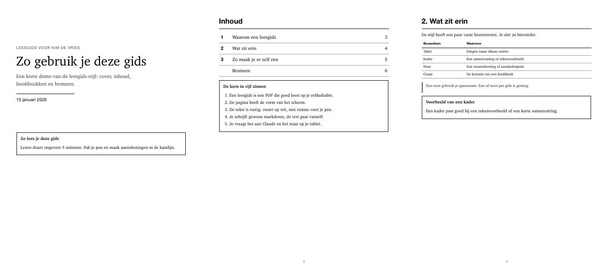
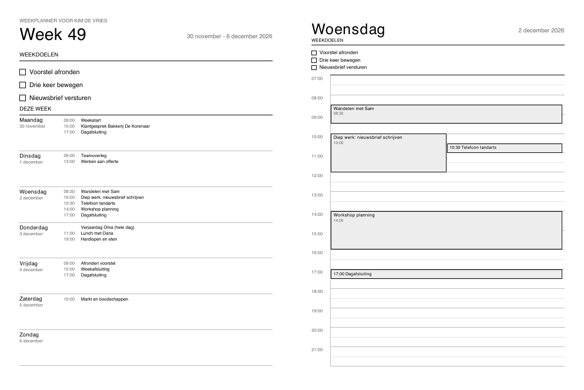

# remarkable-skills

Vier skills voor Claude Code waarmee je je reMarkable slimmer gebruikt. Je zegt wat je wilt, Claude regelt de rest.

- **remarkable-sturen**: stuur een PDF naar je reMarkable.
- **remarkable-leesgids**: maak van tekst een rustige leesgids-PDF in het formaat van je scherm.
- **nieuwsbrief-naar-remarkable**: zet een nieuwsbrief of artikel (link of tekst) op je reMarkable.
- **weekplanner**: een simpele weekplanner met je agenda per uur en je 3 weekdoelen.

## Voor wie is dit?

Voor ondernemers en andere lezers met een reMarkable die Claude Code gebruiken. Je hoeft niet te kunnen programmeren. Je typt alleen een paar commando's over en daarna praat je gewoon met Claude.

Het werkt op een Mac en op Linux. Windows ondersteunen de skills niet.

## Zo ziet het eruit

Leesgids:



Weekplanner (weekoverzicht en een dagpagina):



Complete voorbeeld-PDF's staan in de map `examples/`.

## Installatie, stap voor stap

Je gebruikt de Terminal (op een Mac: druk op Cmd + spatie, typ "Terminal" en druk op Enter).

### Stap 1. Installeer Claude Code

Volg de uitleg op https://docs.claude.com/en/docs/claude-code/overview en log in. Test het: typ `claude` in de Terminal. Je ziet dan een chatvenster. Sluit af met `Ctrl + C` twee keer.

### Stap 2. Installeer Python 3 en de hulpprogramma's

1. Controleer Python: typ `python3 --version`. Zie je een nummer vanaf 3.9? Dan is het goed. Anders installeer je Python van https://www.python.org/downloads/.
2. Installeer poppler. Dit heb je nodig voor de paginanummers in de leesgids. Op een Mac met Homebrew (https://brew.sh): `brew install poppler`. Op Linux: `sudo apt install poppler-utils`.
3. Je hebt een browser nodig: Google Chrome, Brave of Chromium. Een van die drie is genoeg. Je ziet hem niet openen. De skills gebruiken hem op de achtergrond om PDF's te maken, zonder geluid en zonder JavaScript.

### Stap 3. Download deze repo

Kopieer deze regel in de Terminal en druk op Enter:

```bash
git clone https://github.com/rogierlive/remarkable-skills.git ~/remarkable-skills
```

Liever zonder `git`? Ga naar https://github.com/rogierlive/remarkable-skills, klik op de groene knop **Code** en kies **Download ZIP**. Pak de zip uit. De map heet dan `remarkable-skills-main`. Hernoem hem naar `remarkable-skills` en zet hem in je thuismap.

Ga in de Terminal naar die map:

```bash
cd ~/remarkable-skills
```

Installeer de Python-onderdelen in een eigen, afgeschermde omgeving. Zo raak je de rest van je computer niet aan. Kopieer deze twee regels:

```bash
python3 -m venv ~/.remarkable-skills-venv
~/.remarkable-skills-venv/bin/pip install -r requirements.txt
```

De skills vinden deze omgeving vanzelf. Je hoeft hem niet aan te zetten.

### Stap 4. Installeer rmapi en koppel je reMarkable

`rmapi` is het kleine programma dat bestanden naar je reMarkable Cloud stuurt. Wij gebruiken de versie van ddvk, omdat die nog wordt bijgehouden.

1. Ga naar https://github.com/ddvk/rmapi/releases en download de nieuwste versie voor jouw computer (Mac of Linux).
2. Pak het uit en zet het programma `rmapi` in een map waar je Terminal het kan vinden. Op een Mac gaat dat zo (je typt je wachtwoord, je ziet het niet):

   ```bash
   sudo mkdir -p /usr/local/bin
   sudo mv ~/Downloads/rmapi /usr/local/bin/
   ```

   Staat `rmapi` na het uitpakken ergens anders? Pas het pad in de tweede regel dan aan.
3. Op een Mac kan het zijn dat je Mac het blokkeert. Ga dan naar Systeeminstellingen, Privacy en beveiliging, en kies "Toch toestaan".
4. Draai eenmalig `rmapi` in de Terminal.
5. Het programma vraagt om een code. Open https://my.remarkable.com/device/desktop/connect in je browser, log in en kopieer de eenmalige code.
6. Plak de code in de Terminal en druk op Enter. Krijg je daarna een eigen prompt van rmapi? Typ `exit` en druk op Enter.
7. Test: typ `rmapi ls`. Zie je je mappen? Dan werkt het.

### Stap 5. Zet je instellingen klaar

Je instellingen staan in een bestand in je thuismap: `~/.remarkable-skills.env`. Maak het aan vanuit het voorbeeld en open het:

```bash
cp .env.example ~/.remarkable-skills.env
open -e ~/.remarkable-skills.env
```

(Op Linux: open het bestand met je eigen teksteditor.) Vul in:

- `REMARKABLE_NAAM`: je naam, voor op de cover van je leesgidsen.
- `REMARKABLE_MAP`: de map op je reMarkable waar de bestanden in komen, bijvoorbeeld `/Leesgidsen`.
- Voor de weekplanner: `WEEKPLANNER_ICAL_URL` en `WEEKPLANNER_DOELEN`. Hoe je het iCal-adres vindt, staat in `skills/weekplanner/SKILL.md`.

Aanhalingstekens zijn niet nodig. Een regel ziet er zo uit: `REMARKABLE_NAAM=Kim de Vries`.

Het bestand staat buiten deze map. Zo komt het nooit per ongeluk in Git. Wil je een ander bestand gebruiken? Zet dan `REMARKABLE_SKILLS_ENV=/pad/naar/bestand` in je omgeving.

### Stap 6. Zet de skills bij Claude

Kopieer de map `skills` naar de plek waar Claude Code zijn skills zoekt.

Voor alle projecten:

```bash
mkdir -p ~/.claude/skills
cp -R skills/* ~/.claude/skills/
```

Of alleen voor een bepaald project: kopieer ze naar `.claude/skills/` in die projectmap.

Belangrijk: zet alle vier de skills bij elkaar. De skills `nieuwsbrief-naar-remarkable` en `weekplanner` gebruiken de andere twee.

Start Claude Code opnieuw (`claude`). Klaar.

## Zo gebruik je het

Typ gewoon wat je wilt in Claude Code.

| Je zegt | Wat er gebeurt |
|---|---|
| "Stuur dit naar mijn reMarkable" (met een PDF) | De PDF komt in je reMarkable Cloud |
| "Maak een leesgids van notities.md" | Claude maakt een PDF in leesgids-stijl |
| "Maak een leesgids van https://... en zet hem op mijn reMarkable" | Link wordt een leesgids en gaat naar je tablet |
| "Maak mijn weekplanner" | Claude vraagt om je 3 weekdoelen en maakt de PDF |
| "Maak mijn weekplanner voor volgende week en stuur hem naar mijn reMarkable" | PDF wordt gemaakt en verstuurd |

Na het sturen synchroniseert je tablet binnen een paar minuten. Wil je het meteen? Tik op je reMarkable op het sync-icoon.

## Proberen zonder je reMarkable

Maak een voorbeeld-weekplanner met de demo-agenda:

```bash
bash skills/weekplanner/maak.sh --ics examples/demo-agenda.ics --week-start 2026-11-30 --doelen "Een|Twee|Drie" -o mijn-test.pdf
```

Maak een voorbeeld-leesgids:

```bash
bash skills/remarkable-leesgids/assets/render.sh skills/remarkable-leesgids/assets/voorbeeld.md mijn-gids.pdf
```

Testen of het sturen werkt, zonder echt te uploaden:

```bash
bash skills/remarkable-sturen/sturen.sh --dry-run mijn-gids.pdf
```

Open de PDF's om ze te bekijken: `open mijn-test.pdf mijn-gids.pdf`.

Wil je zien dat een kwaadaardige webpagina niets kan doen in je leesgids? Draai dan `bash tests/test_veiligheid.sh`.

## Privacy

- Alles draait op je eigen computer. Er is geen server van mij.
- De sleutel van je reMarkable (door `rmapi` aangemaakt) blijft in je eigen thuismap. Deze repo bevat hem niet en leest hem niet.
- Je geheime agenda-adres staat alleen in je eigen `~/.remarkable-skills.env`, buiten deze map. De skills tonen het adres nooit, ook niet in een foutmelding.
- Tekst van een webpagina wordt platte tekst. Scripts, iframes, afbeeldingen en links van die pagina komen niet in je leesgids. De browser maakt de PDF zonder JavaScript.
- Bij een link of artikel haalt je computer de pagina zelf op. De tekst gaat daarna wel langs Claude, want Claude werkt ermee. Plak geen vertrouwelijke tekst als je dat niet wilt.

## Als iets niet werkt

| Probleem | Oplossing |
|---|---|
| "rmapi is niet geïnstalleerd" | Doe stap 4 opnieuw. Test met `rmapi ls`. |
| "Geen Chrome, Brave of Chromium gevonden" | Installeer een van de drie, of zet `REMARKABLE_BROWSER=/pad/naar/browser` in `~/.remarkable-skills.env`. |
| "Module ... ontbreekt" | Doe de twee `venv`-regels uit stap 3 opnieuw. |
| "externally-managed-environment" bij `pip` | Je gebruikte `pip3` los. Gebruik de twee `venv`-regels uit stap 3. |
| "poppler ontbreekt" | Op een Mac: `brew install poppler`. |
| Inlogfout bij rmapi | Draai `rmapi`, en plak een nieuwe code van my.remarkable.com. |

## Extra opties (op aanvraag)

De skills zijn bewust simpel. Meer kan, op aanvraag:

- quotes op de dagpagina's van je weekplanner;
- een klantenteller of andere cijfers (KPI's) op je weekpagina;
- eigen covers met je eigen foto of huisstijl;
- automatisch elke vrijdag een verse weekplanner op je reMarkable, via een geplande taak;
- een koppeling met je mailbox, zodat je nieuwsbrieven vanzelf op je reMarkable komen.

Wil je dit ook? Stuur Rogier een appje via rogier.live.

## Wat zit er in deze repo

```
skills/
  remarkable-sturen/            sturen.sh, SKILL.md
  remarkable-leesgids/          SKILL.md, assets/build.py, assets/render.sh, assets/voorbeeld.md
  nieuwsbrief-naar-remarkable/  SKILL.md, nieuwsbrief.sh, artikel_naar_md.py
  weekplanner/                  SKILL.md, weekplanner.py, maak.sh
examples/                       demo-agenda.ics en voorbeeld-PDF's
docs/                           afbeeldingen voor deze README
tests/                          test_veiligheid.sh
.env.example                    voorbeeld van je instellingen (kopieer naar ~/.remarkable-skills.env)
```

## Licentie

MIT. Zie het bestand `LICENSE`.

Gemaakt door Rogier van Wagtendonk · rogier.live
